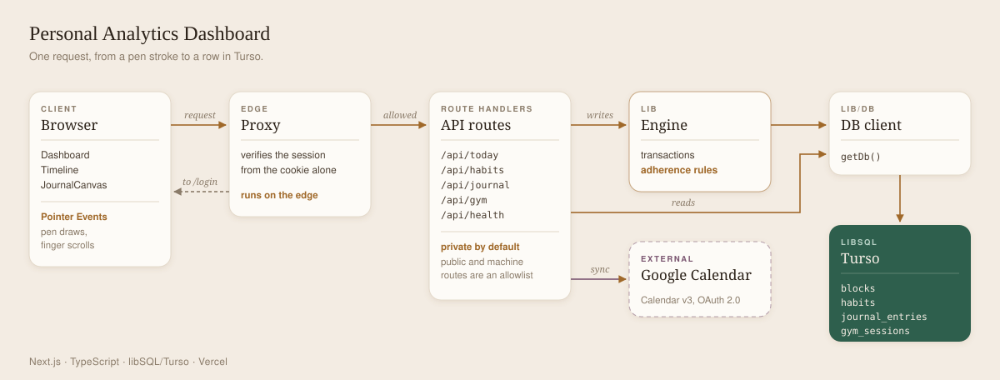

# Personal Analytics Dashboard

Live: http://taxiivation-dashboard.vercel.app/

The dashboard that combines all the prior systems I'd used to organize my life. 

Google Calendar, MyFitnessPal, Hevy, MySteps, even my physical journals were hard to keep track of at the same time, making it hard to stay motivated while balancing everything.

This personal analytics dashboard combines all of that: my journal, my calendar, and my metrics (steps, gym logs, calories). It then tracks my adherence based on that data-- adherence being how much of the plan I set out for myself I actually stuck to. (Initially measuring a productivity score proved to be demotivating and inaccurate.)

Google Calendar syncs and shows the time blocks based on events I have for the day-- which I tick as adhered, skipped, or drifted. My daily habits have individual streaks, my health pillar has my gym log entries, and my goals progress by subgoals. The journal allows both typed and handwritten entries-- a canvas allows a stylus to draw and a finger to scroll, told apart by Pointer Events ordering. The stats page then combines all of my data into charts where I can see my monthly history and trends for every single metric I track in my life. 

## Features

| Feature | Description |
| --- | --- |
| Adherence tracking | Planned blocks are marked done, partial, or drifted. Adherence is computed per day and per week. |
| Timeline | Daily schedule with windows, groups, and notes. |
| Calendar sync | Google Calendar over OAuth 2.0. |
| Habits | Dailies, one-off tasks, streaks |
| Goals | Goals, subgoals-- part of the career pillar rings. |
| Journal | Typed and drawn entries. Pen draws, finger scrolls. |
| Gym log | 3-year backlog migrated from a mobile tracking app. |
| Steps | Pushed in by an external device through a shared-secret endpoint. |
| Calories and weight | Daily entries and history. |
| Stats | Trends, productivity, and session history. |
| Auth | Single user. Passcode login, signed session cookie. |

## Screenshots

<table>
  <tr><td></td><td></td></tr>
  <tr><td></td><td></td></tr>
</table>

## Architecture

Stack: Next.js, TypeScript, libSQL/Turso, Vercel.

### Layers

| Layer | Role |
| --- | --- |
| Proxy | Runs on Edge. Verifies the session from the cookie alone. |
| API routes | Private by default. Public and machine routes are an explicit allowlist. |
| Service layer | Rules run server-side in transactions, not on the client. |
| DB client | Turso in production, `local.db` in development. |
