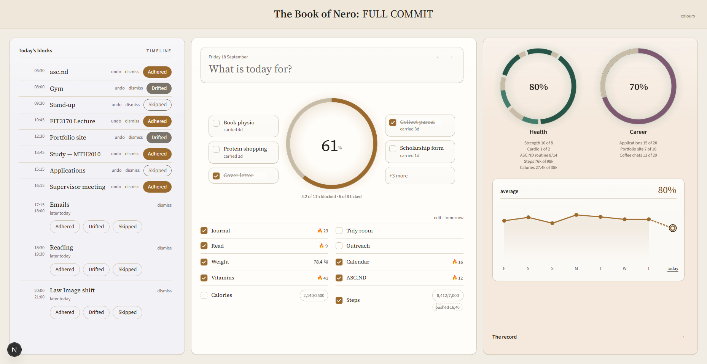
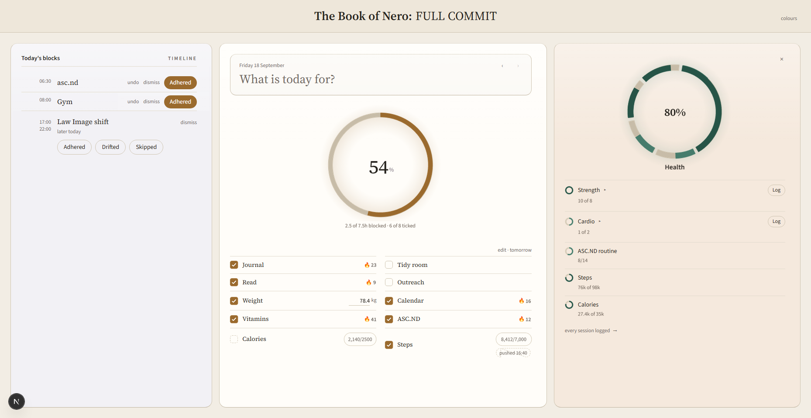
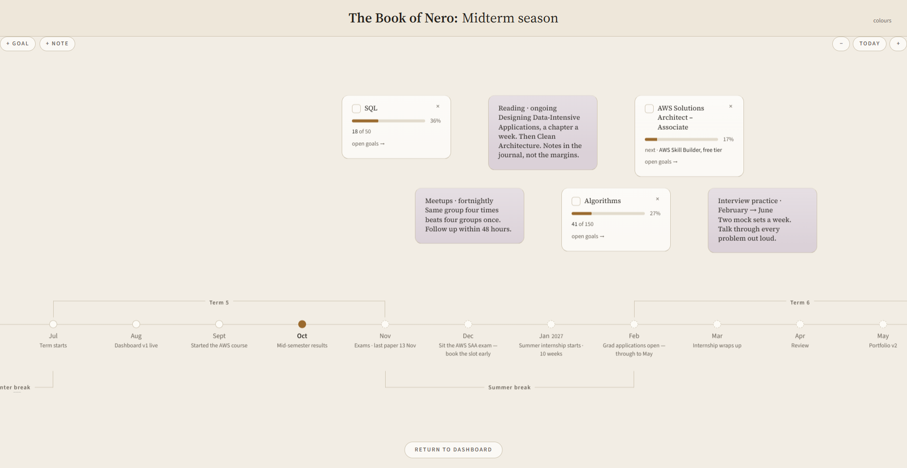
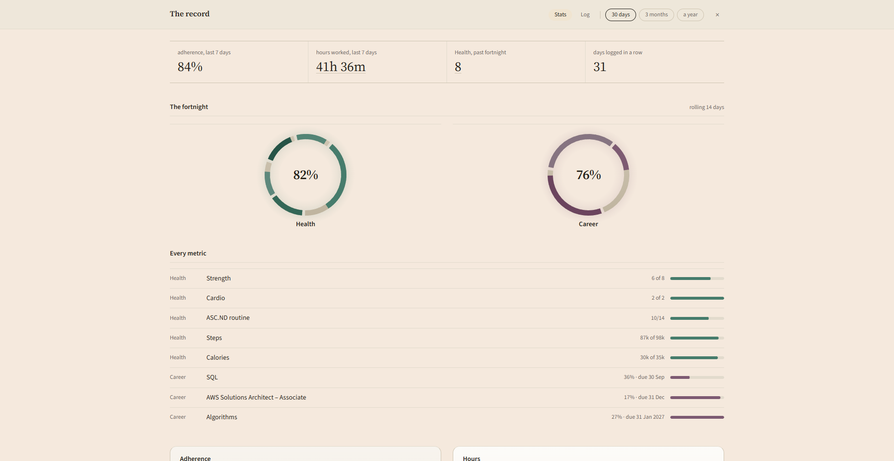
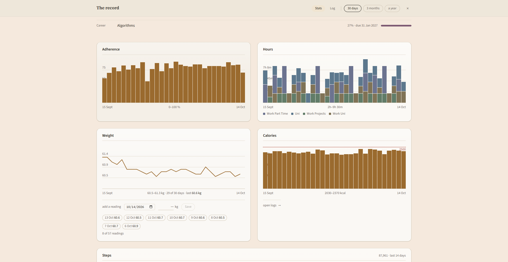
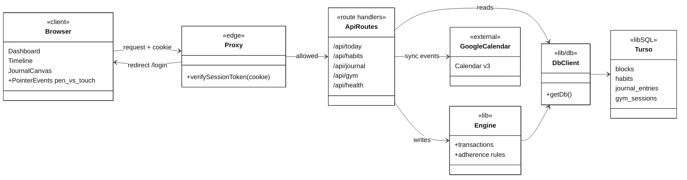

# Personal Analytics Dashboard

Live: http://taxiivation-dashboard.vercel.app/

All the systems I used to organize my life were disjointed-- it was hard to keep track of everything, so I put it all into one place.

A personal daily tracker. It combines journals, calendars, and metrics (steps, gym logs, calories) into one dashboard that tracks adherence. It measures whether I did what I planned, not how much I got done.

Each day starts from the plan. Google Calendar events sync in and shows the time-blocks I have for the day-- which I tick as adhered, skipped, or drifted. Habits get per-item streaks, and goals progress by their completed subgoals. At night I write my journal. When I'm feeling lazy I'll type it in, but when I'm occassionally in the mood for expression, I write the entry on a tablet stylus. The pen draws and a finger scrolls, told apart by Pointer Events ordering. The stats page then shows my monthly history, trends, and hours worked by category. 

## Features

| Feature | Description |
| --- | --- |
| Adherence tracking | Planned blocks are marked done, partial, or drifted. Adherence is computed per day and per week. |
| Timeline | Daily schedule with windows, groups, and notes. |
| Calendar sync | Google Calendar over OAuth 2.0. |
| Habits and goals | Habits, one-off habits, goals, subgoals, streaks, pillar rings. |
| Journal | Typed and drawn entries. Pen draws, finger scrolls. |
| Gym log | 3-year backlog migrated from a mobile tracking app. |
| Steps | Pushed in by an external device through a shared-secret endpoint. |
| Calories and weight | Daily entries and history. |
| Stats | Trends, productivity, and session history. |
| Auth | Single user. Passcode login, signed session cookie. |

## Screenshots

<table>
  <tr><td></td><td></td></tr>
  <tr><td></td><td></td></tr>
  <tr><td></td><td></td></tr>
</table>

## Architecture

Stack: Next.js, TypeScript, libSQL/Turso, Vercel.

### Layers

| Layer | Role |
| --- | --- |
| Proxy | Runs on Edge. Verifies the session from the cookie alone. |
| API routes | Private by default. Public and machine routes are an explicit allowlist. |
| Engine | Rules run in transactions, not on the client. |
| DB client | Turso in production, `local.db` in development. |
